# JVIC
**JVic** is a VIC 20 emulator written in Java, using the libGDX cross-platform development framework, targeting primarily HTML5 and the web. Being such, it can run directly in your web browser:

https://vic20.games

The UI of JVic has been designed primarily with mobile devices in mind, so give it a try on your Android phone! 

## Features
- Intuitive, familiar, mobile-like UI, with game selection screens. Swipe or click to the right:
  
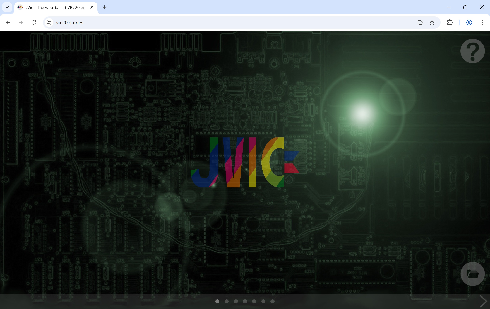           |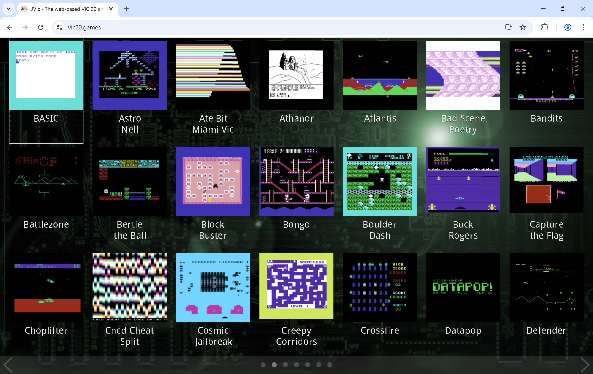 
:-------------------------:|:-------------------------:

- Support for direct URL path access to individual games:
  - e.g. [https://vic20.games/#/pitfall](https://vic20.games/#/pitfall)
  - e.g. [https://vic20.games/#/datapop](https://vic20.games/#/datapop)
  - e.g. [https://vic20.games/#/impossiblator-3](https://vic20.games/#/impossiblator-3)
  - Or into BASIC: [https://vic20.games/#/basic](https://vic20.games/#/basic)
  - Or into BASIC with different RAM and/or TV setting: [https://vic20.games/#/basic/16k/pal](https://vic20.games/#/basic/16k/pal)
  - Or into BASIC with the midpoint PAL palette: [https://vic20.games/#/basic/16k/pal/mid](https://vic20.games/#/basic/16k/pal/mid)
- Support for loading games via a ?url= request parameter:
  - e.g. [https://vic20.games/?url=https://raw.githubusercontent.com/raspberrypioneer/VicBoulderDash/refs/heads/main/d64/Vic20%20Boulder%20Dash.d64](https://vic20.games/?url=https://raw.githubusercontent.com/raspberrypioneer/VicBoulderDash/refs/heads/main/d64/Vic20%20Boulder%20Dash.d64)
  - e.g. [http://vic20.games/?url=https://archive.org/download/download_20220510_2209/Vic20_gamebase_v03.zip/Games%2FGorf.zip](http://vic20.games/?url=https://archive.org/download/download_20220510_2209/Vic20_gamebase_v03.zip/Games%2FGorf.zip)
  - e.g. [https://vic20.games/?url=https://ftp.area536.com/mirrors/scene.org/demos/groups/proxima/proxima_ppy.prg](https://vic20.games/?url=https://ftp.area536.com/mirrors/scene.org/demos/groups/proxima/proxima_ppy.prg)
  - e.g. [https://vic20.games/?url=https://www.tokra.de/vic/vicmckracken/vic%20mckracken.d64](https://vic20.games/?url=https://www.tokra.de/vic/vicmckracken/vic%20mckracken.d64)
- Support for games contained within ZIP files:
  - e.g. e.g. [https://vic20.games/?url=https://www.gamesthatwerent.com/wp-content/uploads/2021/04/Game_Moonsweeper-1983ImagicA000.zip&tv=ntsc](https://vic20.games/?url=https://www.gamesthatwerent.com/wp-content/uploads/2021/04/Game_Moonsweeper-1983ImagicA000.zip&tv=ntsc)
- Support for loading games attached to forum posts:
  - e.g. [https://vic20.games/?url=https://sleepingelephant.com/ipw-web/bulletin/bb/download/file.php%3Fid=4946](https://vic20.games/?url=https://sleepingelephant.com/ipw-web/bulletin/bb/download/file.php%3Fid=4946) (you may need to URL encode the ? after file.php as shown)
- Being a PWA (Progressive Web App), it can be installed locally to your device!
- And it also comes as a standalone Java app, for those who prefer Java.

## How to run games from the Home screen
JVic's game selection screens contain a list of over 100 games and demos. These games are NOT packaged with JVic but rather JVic loads the games from well known websites, such as archive.org and sleepingelephant.com.

Start by going to https://vic20.games. This will load the JVic title or home screen. There is a small question mark icon in the top right that pops up a dialog with a brief description and the current version. It mentions that in order to start playing games, simply swipe or click to the right.

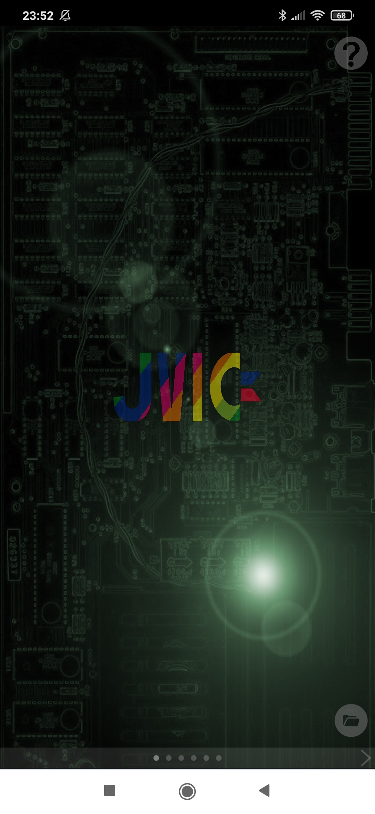           |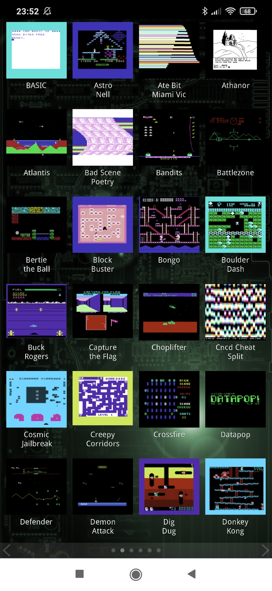      |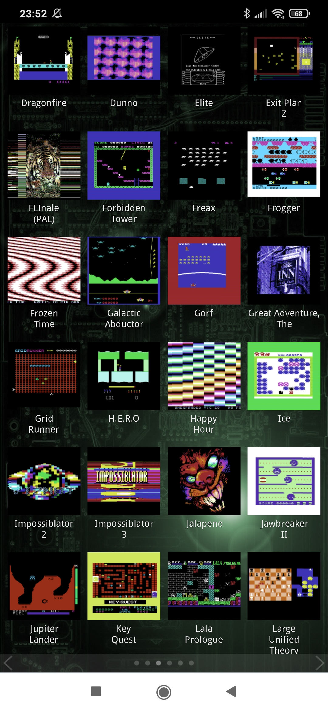 
:-------------------------:|:-------------------------:|:-------------------------:

The screen works in a very similar way to the user interface of a mobile device. If you are accessing the website on a touch screen device, then you can swipe to the right to get to the next page. If you are on desktop, you can use the right arrow key, or drag/fling with your mouse, or click on the small right arrow at the bottom of the screen. Note that it has pagination indicator dots at the bottom of the screen that show how many pages there are, and which of those pages you are currently on. You can also click on those dots to jump directly to that page.

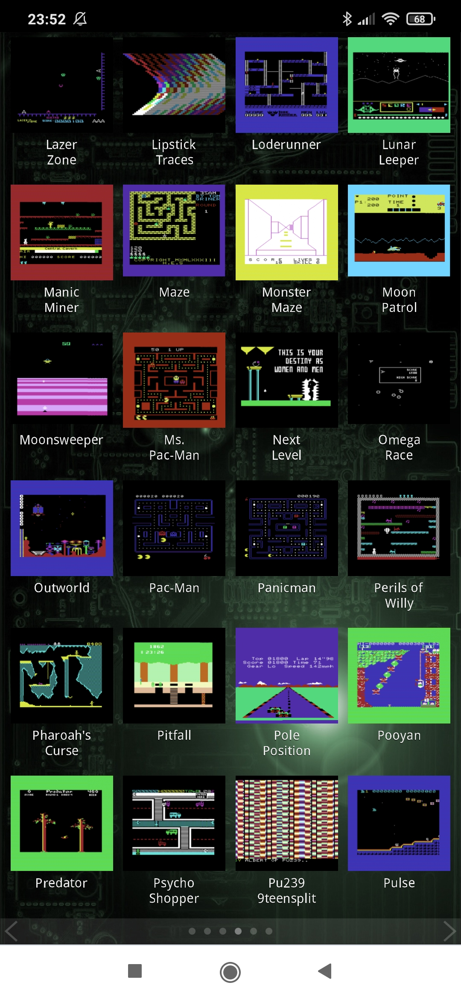           |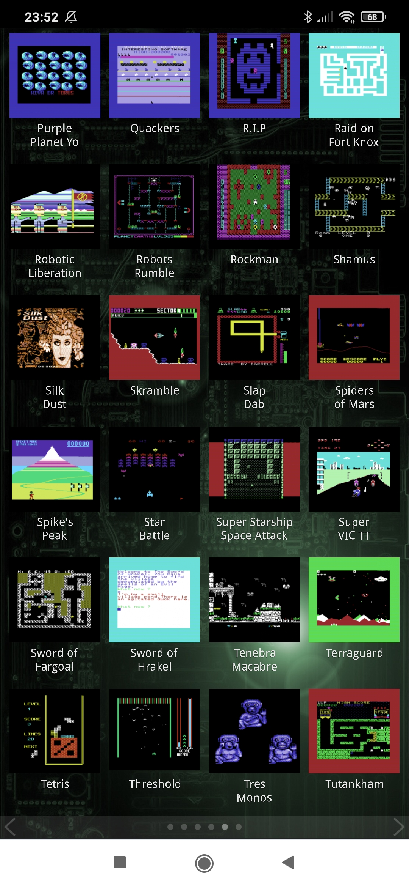      |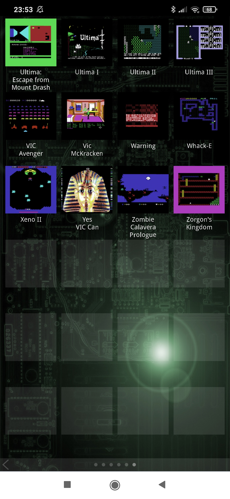
:-------------------------:|:-------------------------:|:-------------------------:

Keyboard navigation within the game selection screens is also possible as follows:

* Left/Right/Up/Down: Navigates by one game in the corresponding direction.
* Home: Goes back to the JVIC title page.
* PgDn: Goes one page of games to the right.
* PgUp: Goes one page of games to the left.
* End: Goes to the last page of games.
* Enter/Space: Runs the selected game, as indicated by the white selection box.
* A-Z: Type the name of a game to scroll straight to the page containing the closest matching game.

### Open File Icon
The JVic title screen also has an Open File icon in the bottom right corner. If you click on this icon, an open file dialog will be shown. You can then select a .d64, .prg, .crt, .tap, or .zip file containing a .d64, .prg, .crt or .tap, for the emulator to run. This can be used for programs that are not available in the game selection pages, such as games that are still being developed, or that are currently for purchase through services such as itch.io and Steam. 

### Drag and Drop
As an alternative to using the Open File icon, you can instead simply drag and drop a VIC 20 program onto the JVic home screen. This will work for any VIC 20 .d64, .prg, .crt, .tap, or .zip file containing a .d64, .prg, .crt or .tap. The dropped program will be immediately run by the emulator.

### URL Parameters
There are a handful of URL parameters that can be used when loading games. This is useful mainly when loading a program using the ?url= request parameter. Without using the following request parameters, JVic will attempt to make a best guess as to what settings to use, but sometimes it will get it wrong. This is when using these parameters will become useful, as it forces certain settings to be used:

* ram: The amount of RAM to use (0, UNEXP, 3K, 8K, 16K, 24K, 32K, 35K), e.g. ram=16K
* tv: Selects between PAL and NTSC, e.g. tv=NTSC
* type: Specifies the type of file being loaded, in case it isn't clear what it is (DISK, TAPE, CART, PRG), e.g. type=CART
* filter: Selects the screen filtering mode. Use filter=nearest for sharp nearest-neighbour scaling, filter=linear for standard linear filtering, or a number between 0.0 and 1.0 for the soft filter blend amount, e.g. filter=0.35
* palette: Selects the PAL palette mode. Currently palette=MID uses a midpoint palette instead of alternating the odd and even PAL palettes
* joystick: Whether the joystick starts ON or OFF, e.g. joystick=on. Programs loaded via ?url= start with it OFF, and programs from the game list start with it ON (see Joystick keys below)
* diskwrite: Whether changes to a disk are kept: off, temp (until the page is closed) or persist, e.g. diskwrite=temp
* settings: settings=hidden hides the settings screen and ignores any saved settings (see Settings below)

URL parameters apply only to the program they start, and they win over any saved settings (see Settings below).

Examples:

* [https://vic20.games/?url=https://www.gamesthatwerent.com/wp-content/uploads/2021/04/Game_Moonsweeper-1983ImagicA000.zip&tv=ntsc&filter=nearest](https://vic20.games/?url=https://www.gamesthatwerent.com/wp-content/uploads/2021/04/Game_Moonsweeper-1983ImagicA000.zip&tv=ntsc&filter=nearest)
* [https://vic20.games/#/basic?tv=pal&palette=mid](https://vic20.games/#/basic?tv=pal&palette=mid)

## The Machine screen
When a game is run, the machine screen is displayed. It shows the VIC 20 screen and various icons, which may be either at the bottom of the screen (for portrait) or to the sides (for landscape).

The following two screen shots show the icons when running in Chrome on a Windows machine:

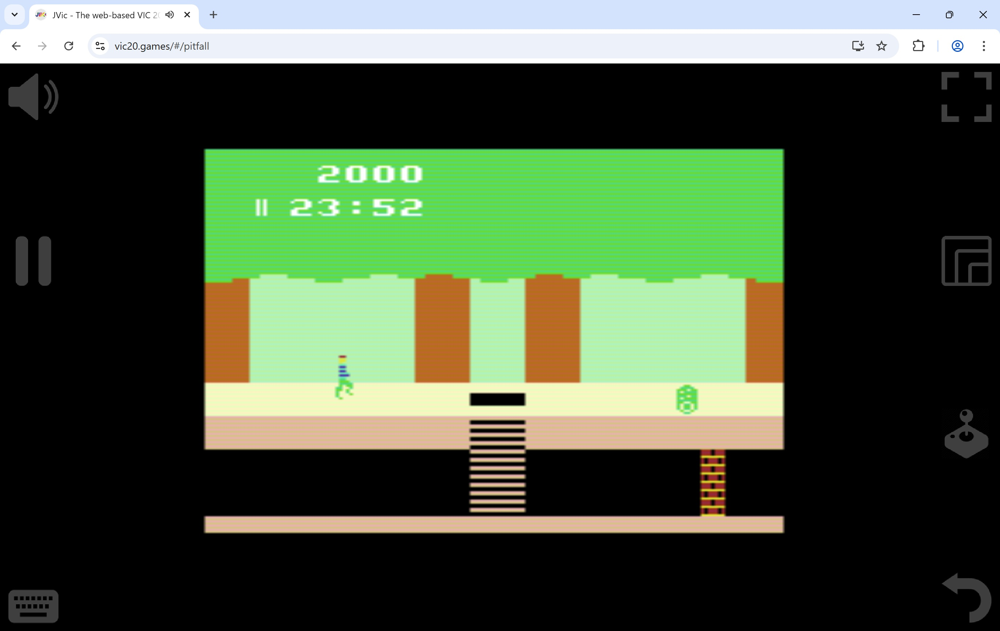           |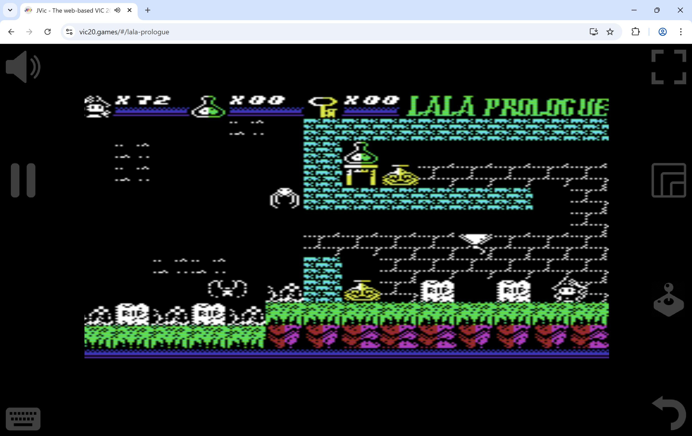 
:-------------------------:|:-------------------------:

And the three below show the placement of the icons when running in Portrait mode as an installed PWA (Progressive Web App) on an Android phone:

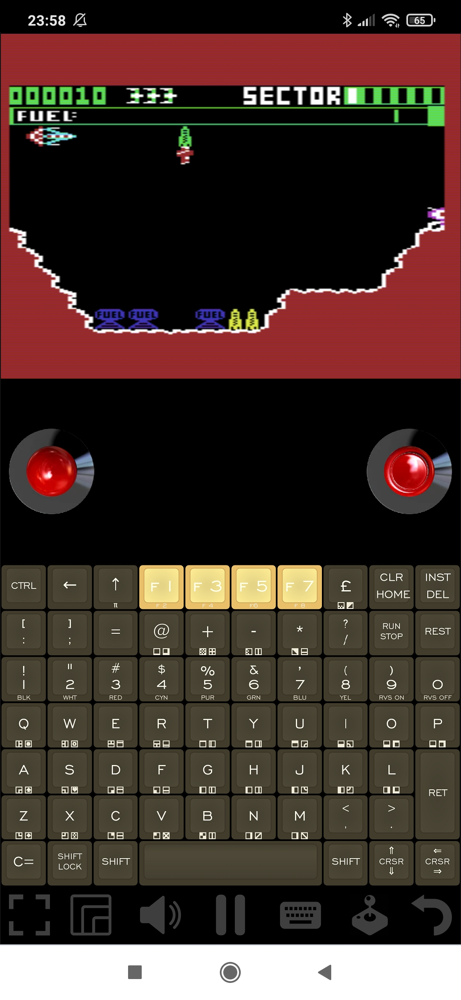           |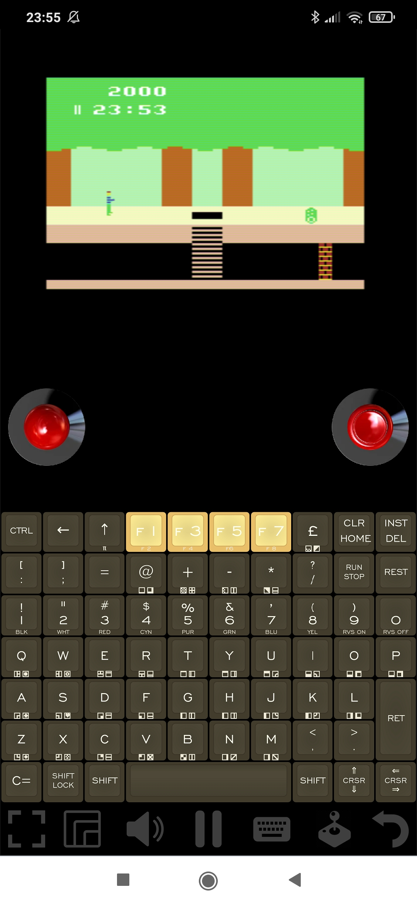      |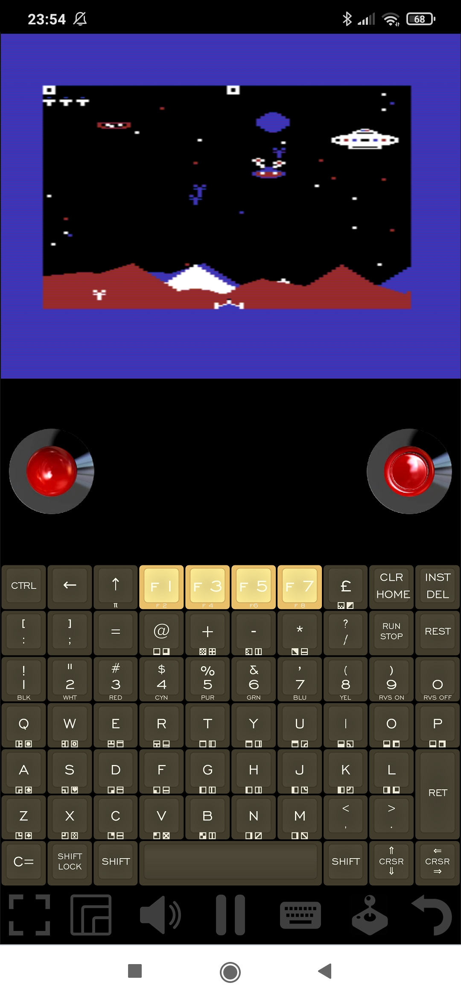 
:-------------------------:|:-------------------------:|:-------------------------:

The function of these icons is as follows:

Icons                                 | Description                          |Icons                                 | Description                          
:------------------------------------:|:------------------------------------:|:------------------------------------:|:------------------------------------:
       |Toggles full screen mode.             |     |Toggles display of the keyboard.
       |Turns on sound.                       |         |Turns off sound.
             |Pauses the emulator.                  |              |Resumes emulation.
     |Toggles display of joystick.          |        |Goes back to the JVic home screen.
         |Opens the menu (see below).           |                                      |

The menu icon opens a list of actions, each of which also has a keyboard shortcut: Settings, Screen size (landscape only), Reset, Power cycle, Quick save, Quick load, Screenshot, Warp speed, Reset disk, Monitor, Keyboard shortcuts, and on Desktop, Copy screen text and Paste text. An action is only listed where it is supported, e.g. Monitor isn't available in every build.

It is important to note that if you have accessed JVic directly via a game URL (either one of the /#/ paths, or by using the ?url= request parameter), then the speaker icon will initially be muted. This is because web browsers do not allow sound to be played automatically without a user interaction. In this scenario, you will need to click the speaker icon to turn sound on.

If instead you have started a game by clicking on the game's thumbnail image from JVic's game list screen, then sound will be unmuted automatically.

### Keyboard shortcuts
When the machine screen is active, the following physical keyboard shortcuts are supported:

Shortcut                          | Action
:---------------------------------|:-----------------------------------------------
ALT-O                             | Opens or closes the settings screen (also on the home screen).
ALT-D                             | Toggles full screen mode.
ALT-ENTER                         | Also toggles full screen mode.
F11                               | Also toggles full screen mode.
ALT-J                             | Changes the joystick alignment.
ALT-K                             | Toggles the on-screen keyboard.
ALT-P                             | Toggles pause/resume.
ALT-SHIFT-P                       | Pauses, or if already paused, runs the machine for one frame.
ALT-S                             | Toggles sound on or off.
ALT-Q/X                           | Opens the quit confirmation dialog.
ALT-W                             | Toggles warp speed (mainly for Desktop)
ALT-Y                             | Saves a screenshot (a PNG download on the web).
PAUSE                             | Also saves a screenshot.
ALT-MINUS                         | Rotates through screen sizes.
ALT-Z                             | Resets the mounted disk to its original image (asks first).
ALT-B                             | Toggles the FPS/performance overlay.
ALT-H/M                           | Opens or closes the debug monitor (Desktop and web).
ALT-F9                            | Resets the machine, keeping memory. No confirmation.
ALT-F12                           | Turns the machine off and on again, clearing memory. No confirmation.
ALT-F11                           | Quick save: saves the machine's state to this program's quick save slot.
ALT-F10                           | Quick load: loads the state from this program's quick save slot.
ALT-DELETE                        | Copies the text on the screen to the clipboard (Desktop only).
ALT-INSERT                        | Types the clipboard's text into the VIC-20 (Desktop only).

These shortcuts are handled by JVic itself rather than being passed through to the emulated VIC-20 keyboard.

There is one quick save slot per program. On Desktop, quick saves are files in the jvic_saves folder in your home directory, so they last between runs. On the web, they last until the page is closed or reloaded. A quick save only loads into a machine set up the same way (machine type, RAM expansion and cartridge).

Pasted text is typed in as the VIC-20 reads the keyboard. With the normal upper case character set, letters of either case are typed as plain letters, so a BASIC listing pastes in as text rather than graphics characters. With the lower case set, the case is kept.

### Joystick keys
The joystick icon (or ALT-J) turns the joystick ON and OFF. While it is ON, the arrow keys act only as the joystick, and while it is OFF they act only as the VIC-20 cursor keys. This stops games that read both, such as Moon Patrol (which uses the cursor keys to centre the screen), from seeing cursor key presses while you play. Turn the joystick OFF to use the cursor keys, then back ON to play.

Key                               | Joystick ON          | Joystick OFF
:---------------------------------|:---------------------|:---------------------
Arrow keys                        | Joystick directions  | Cursor keys
DELETE                            | Fire                 | Fire
INSERT                            | Fire                 | INST (SHIFT + INST/DEL)
Numeric keypad (8 directions, 0)  | Joystick, 0 is fire  | Joystick, 0 is fire

Games from the game list start with the joystick ON, unless they are configured otherwise. BASIC and programs you open yourself start with it OFF.

## Settings
JVic's settings screen is opened from the gear icon in the bottom left corner of the home screen, from Settings in the machine screen's menu, or with ALT-O. Settings are saved, so they are still there the next time you use JVic: in the browser's storage on the web, and in the .prefs folder in your home directory on Desktop.

When it is opened over a running program, the settings screen sits beside the VIC 20 screen (or below it in portrait), so that you can see the effect of display changes as you make them. The machine is paused while it is open, unless you turn that off.

### This program and All programs
Over a running program, the settings screen starts on **This program**, which shows the settings the program uses and saves any change for that program only. Switch to **All programs** (or press TAB) to change the settings that every program uses unless something more specific says otherwise. From the home screen, the settings are always for all programs.

Under each setting, a line says where its value comes from: set for this program, set by this program (its entry in the game list), from the settings for all programs, or the default. Where a value has been saved, a Reset button next to it goes back to the value it would otherwise have. "Reset this program's settings" and "Reset all settings" are under General.

Settings that are the same for all programs (such as screen size) say so, and changing them on This program changes them for all programs.

### Which value wins
From lowest to highest, a setting's value comes from:

1. JVic's default.
2. Your setting for all programs.
3. The program's own entry in the game list (or, for a program you open yourself, "NTSC" in its file name).
4. Your setting for this program.
5. URL parameters or autorun-config.txt, for that run only. These are never saved.

So a game in the list that needs 16K NTSC still gets it if your general setting is unexpanded PAL, but you can still change it for that game. Games in the list use their own RAM and joystick settings (auto detection and ON, unless their entry says otherwise), so the RAM setting for all programs mainly affects BASIC and programs you open yourself, and the joystick setting for all programs affects programs you open yourself.

### When changes take effect
Display settings (screen filter, soft amount, PAL palette, screen size, FPS overlay) and the touch joystick side are applied straight away. A change to the TV standard or the RAM expansion needs the program to be restarted, so the settings screen offers "Restart now" (it can also be reached from the keyboard, by moving down past the last setting). The joystick at start, sound at start and disk write settings are used the next time a program starts.

### The settings
Section     | Setting                       | Choices
:-----------|:------------------------------|:-------------------------------------------------------------
Machine     | TV standard                   | PAL, NTSC (VIC44 and VIC44K with "Show advanced options")
Machine     | RAM expansion                 | Auto, Unexpanded, 3K, 8K, 16K, 24K, 32K, 35K
Display     | Screen filter                 | Sharp, Smooth, Soft
Display     | Soft amount                   | 0.00 to 1.00 (shown for the soft filter)
Display     | PAL palette                   | Alternating, Midpoint
Display     | Screen size                   | Fit, 2x to 8x (landscape; only sizes that fit are used)
Display     | Show FPS                      | On, Off
Sound       | Sound at start                | On, Off (web browsers still need a tap before sound can play)
Controls    | Joystick at start             | On, Off
Controls    | Touch joystick side           | Left, Right
Media       | Disk writes                   | Automatic, Off, This session, Save
General     | Pause while settings are open | On, Off
General     | Show advanced options         | On, Off

The settings screen can be used with the keyboard: UP and DOWN move between settings, LEFT and RIGHT change the value, ENTER opens a section or presses a button, TAB switches between This program and All programs, and ESC goes back.

## Installing the web app on your device.
JVic follows the PWA (Progressive Web App) spec and can therefore be installed on your device. When you go to the https://vic20.games web site, and you haven't previously installed JVic, then the browser may promote it to you for installation. In Chrome, one of the ways it does this is to show a little installation icon at the end of the browser location field, as indicated by the yellow arrow in the screenshot below. Clicking on that icon will install JVic as if it were a standalone app on your device.

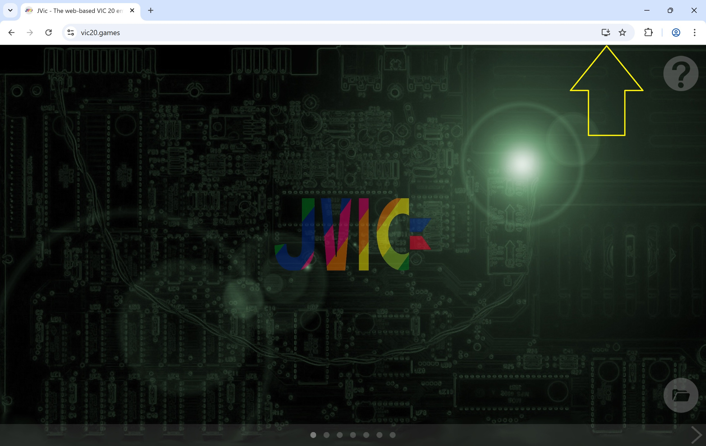           |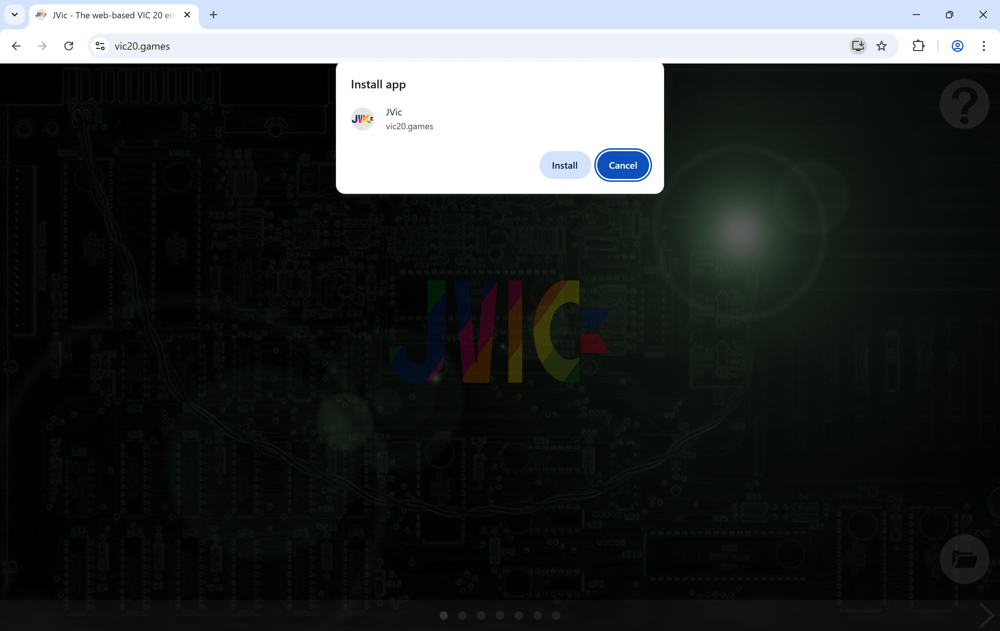 
:-------------------------:|:-------------------------:

On Windows, this means that you'll see JVic in your Windows menu, and it can be pinned to your task bar, if you choose to do that. On a mobile device, such as an Android phone, it will install it alongside all the other apps on your phone and can then be launched like any other standalone app on your phone. Internally, it still runs the web version though from the website, so is automatically kept up to date with new releases.

## Installing the Java verson
JVic is a cross platform application. The release build creates both the web version, which is deployed to https://vic20.games, and also a Java version that is available under the Releases page of the github project:

https://github.com/lanceewing/jvic/releases/latest

The .jar file is an executable jar. If you have the Java virtual machine installed on your computer, then running the downloaded JVic jar is as easy as double clicking the .jar file.

Java runs on many platforms, including Windows, Mac, and Linux, and so this is another way to run JVic on your device. On Windows, for example, you could choose to install the web version (as described earlier), or you could download and run the Java version. If JVic does not start up when you double click the jar, then it most likely means that you do not have Java installed.

Not everyone is a fan of Java desktop apps, due to the overhead of downloading and installing the Java virtual machine, so if you do not already have Java installed, then I would recommend using the web version, as the web version should work on any modern web browser.

## Installing the Android APK
JVic's build process also creates a native Android APK file. This can be found as a separate asset available under the Releases page:

https://github.com/lanceewing/jvic/releases/latest

The .apk file has been signed, but there are no plans to make this available in the Google Play Store. It is provided for those who might like a native Android build as an alternative to installing the web PWA. Simply download the .apk file from the Releases page and your phone should prompt you asking if you'd like to install it. Not being from the Google Play Store though, you'll get some warnings about it coming from an unknown source.

Personally, I prefer to install the web version to my Android phone, as a PWA app (see section above), as its more convenient and updates automatically. You may find that the sound performs better in the native APK version though.

## Running on your own local web server
As the web version of JVic is a essentially static content, you could, if you like, download the release ZIP, extract it, and run it by serving it from your own web server, rather than the vic20.games web site. There are a couple of gotchas with this though: JVic uses some browser APIs that are not enabled by default. For example, it uses SharedArrayBuffer for multiple things (keyboard events, graphics, sound), as it is a very quick way to share data between the web worker that runs the emulation, the audio thread, and the main browser UI thread. In order to enable this API, the web server must set the following two HTTP response headers in every response:

```
Cross-Origin-Opener-Policy: same-origin
Cross-Origin-Embedder-Policy: require-corp
```

(For more details, see here: https://developer.mozilla.org/en-US/docs/Web/API/Window/crossOriginIsolated)

To make this as easy as possible for you, the JVic ZIP file for the web version comes with some .swshtaccess files in three of the folders that are designed to be read by the "Simple Web Server" web server. They are like .htaccess files that you may already be familiar with but for the Simple Web Server instead (SWS). 

1. Download the release ZIP of jvic, e.g.: https://github.com/lanceewing/jvic/releases/download/v1.0.8/jvic-web-v1.0.8.zip
2. Extract the jvic ZIP into a folder.
3. Download Simple Web Server for your platform from here: https://simplewebserver.org/download.html
4. Start up Simple Web Server
5. Click "New Server" button in bottom right corner
6. For the folder path, choose the folder that contains the index.html file from the extracted jvic ZIP
7. Choose your port number. It works with port 80, so that is what I use, but could be anything, e.g. 8080, 8081, etc.
8. Expand the "Advanced Rules" section and tick the "Enable .swshtaccess configuration files" checkbox.
9. Click the "Create Server" button in the bottom right. This will start up the web server..
10. Now go to the web browser and access localhost on the port you chose. It should load the JVic home screen. Scroll to the right to choose a game.

It is the .swshtaccess files within the jvic ZIP that automatically take case of the rest of the Simple Web Server configuration, such as adding those two HTTP response headers mentioned earlier. These are the relative paths if you're interested in seeing what they do:

```
./.swshtaccess
./html/.swshtaccess
./worker/.swshtaccess
```

They mostly do the same thing, which is to add the "Cross-Origin-Opener-Policy" and "Cross-Origin-Embedder-Policy" HTTP response headers mentioned above. The top level .swshtaccess file also sets up the localhost equivalent of the CORS proxy, which is used to load VIC 20 games from other websites, such as sleepingelephant.com.

The Simple Web Server is an Electron app, so not really designed to be used as a full web server. The theory can be applied to any web server though. All you need to do is configure those same features. For example, the vic20.games web site is hosted by Cloudflare Pages, and so it uses a Cloudflare _headers config file to apply those HTTP response headers. This file is also included in the repo, if you are interested in seeing what it does.

## Using autorun-config.txt for embedded deployments
If you want a JVic deployment to boot straight into a bundled game instead of showing the home screen, then place an autorun-config.txt file next to index.html. This is useful when packaging a single game together with JVic for deployment on services such as itch.io, where you want the emulator to start running immediately inside an embedded page.

JVic will read autorun-config.txt automatically on startup, but only when no explicit hash path or URL parameters have been supplied. This means you can still override the default startup behaviour later by launching JVic with the usual URL options.

The file format is one key=value pair per line. Blank lines are ignored, and any line starting with # is treated as a comment.

Supported settings include:

* program: The bundled VIC-20 program to start automatically. This can be a .prg, .d64, .crt, .tap, or .zip file. Paths such as game.prg, ./game.prg, or /game.prg are all resolved relative to the deployed JVic folder.
* ram: The amount of RAM to use (0, UNEXP, 3K, 8K, 16K, 24K, 32K, 35K)
* tv: Selects between PAL and NTSC
* type: Specifies the program type (DISK, TAPE, CART, PRG)
* filter: Selects the screen filtering mode. Use nearest, linear, or a number between 0.0 and 1.0 for the soft filter blend amount
* palette: Selects the PAL palette mode. Default PAL behaviour is to alternative between the odd and even line palettes. Specifying MID for the palette uses a palette that is the mid point between the odd and even palettes. Ignored for NTSC.
* joystick: Whether the joystick starts ON or OFF
* settings: Use settings=hidden to hide the settings screen (the gear icon, the menu's Settings entry and ALT-O). Saved settings are then ignored, so the program always runs exactly as configured here. This matters on itch.io, where all HTML games share the same browser storage, so settings saved for one JVic-based game could otherwise affect another.

The values in autorun-config.txt win over any settings the player has saved.

For example, the following autorun-config.txt file would boot directly into a bundled PRG with explicit machine settings:

```
# Boot straight into the packaged game
program=games/mygame.prg
ram=24k
type=prg
tv=pal
filter=0.25
palette=mid
settings=hidden
```

With that file in place, you can deploy the whole JVic build plus your game file to a static host or embedded web game platform, and JVic will start directly in that program when the page loads.

## Credits and Acknowledgements
This project would not have been possible without the following projects and their authors:

- [libgdx](https://libgdx.com/): The cross-platform game development framework.
- [gdx-liftoff](https://github.com/libgdx/gdx-liftoff): Written by Tommy Ettinger. Used to generate the initial libgdx project boilerplate.
- [gwt-webworker](https://gitlab.com/ManfredTremmel/gwt-webworker): Written by Manfred Trammel. The key to running libgdx gwt code in a web worker.
- [gwt-jszip](https://github.com/ainslec/GWTJSZip): Originally written by Aki Miyazaki, extended by Chris Ainsley.
- [jszip](https://github.com/Stuk/jszip): Written by Stuart Knightley. Used by JVIC to unzip imported games.
- [GWT](https://www.gwtproject.org): Google Web Toolkit, used by libgdx to transpile the JVIC Java code to JavaScript.
- [TeaVM](https://teavm.org): Used by JVic to transpile the TeaVM target to JavaScript.
- [ringbuf.js](https://github.com/padenot/ringbuf.js/blob/main/js/ringbuf.js): Written by Paul Adenot. Used for the keyboard matrix, audio queue and pixel array in JVIC.
- [dialog.js](https://css-tricks.com/replace-javascript-dialogs-html-dialog-element/): Written by Mads Stoumann. Used for most of the dialogs.

